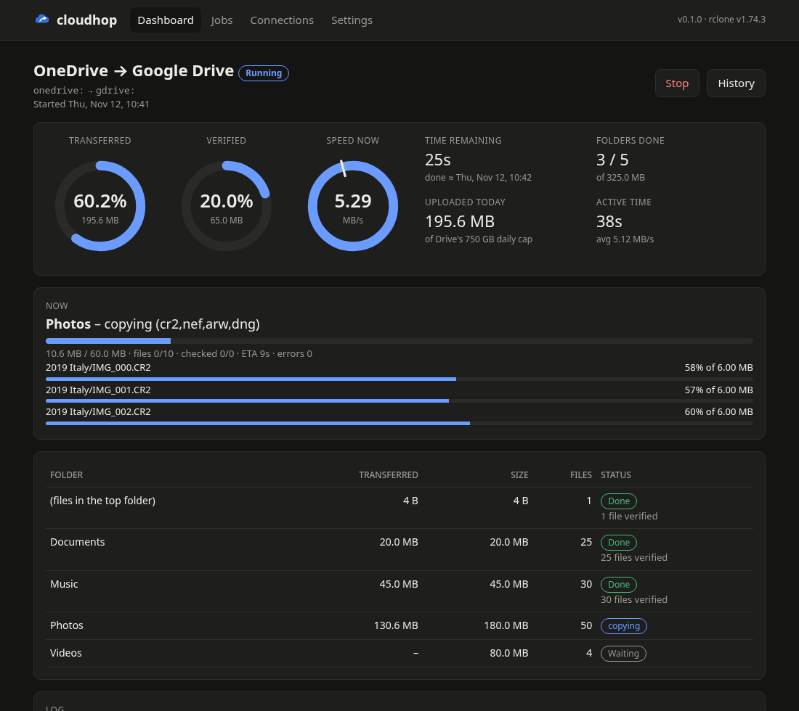
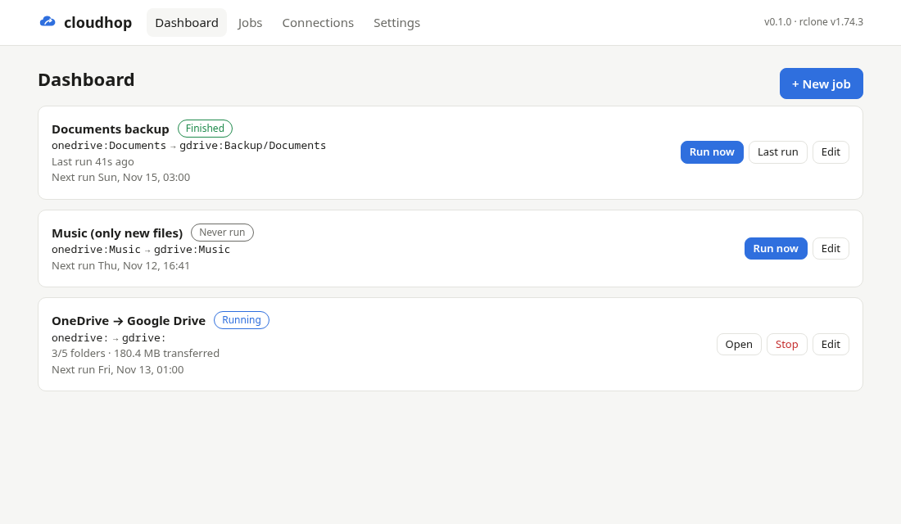

# cloudhop

**Move, copy or back up your files between cloud accounts, from a simple web page on your own computer.**

OneDrive to Google Drive, Dropbox to a USB disk, a nightly backup of your photos: cloudhop sets it up, checks that every file arrived intact and shows you the progress while it works. It's built on [rclone](https://rclone.org), which works with more than 60 storage services.



- **Connections:** add your accounts with a few clicks (logging in happens in your browser), then test them.
- **Jobs:** choose what to copy and where to, and whether to copy, mirror or move. Run it once or on a schedule.
- **Checks every file:** after copying, cloudhop compares the files, so you know they arrived intact. It can then move or delete the originals for you.
- **Pick which files:** only new files, files changed recently, include/leave-out patterns, or send certain file types (for example camera RAW files) to their own folder.
- **Speed control:** set a bandwidth limit, for example slow during the day and full speed at night.
- **Live progress:** see what's done, the speed, time remaining, and the files being copied right now.
- **Handles problems:** a full storage account pauses the job and asks you to free up space. Google Drive's daily upload limit is handled automatically. If the computer restarts, the job continues where it stopped.

Everything runs on your own computer. Your files go directly between your accounts and nothing passes through anyone else's server.

---

## Getting started (no technical knowledge needed)

You need a Windows, Mac or Linux computer with an internet connection. Setup takes about five minutes the first time.

### Step 1: Install “uv” (one time only)

cloudhop is started with a small free tool called **uv**. It takes care of everything else.

**On Windows:**
1. Press the Windows key, type **PowerShell** and open it.
2. Copy this line, paste it into the blue window (right-click pastes) and press Enter:
   ```
   powershell -ExecutionPolicy ByPass -c "irm https://astral.sh/uv/install.ps1 | iex"
   ```
3. When it says it's done, **close the window**.

**On a Mac:**
1. Press ⌘ + Space, type **Terminal** and open it.
2. Copy this line, paste it in (⌘ + V) and press Enter:
   ```
   curl -LsSf https://astral.sh/uv/install.sh | sh
   ```
3. When it says it's done, **close the window** (⌘ + Q).

**On Linux:** open a terminal and run the Mac command above.

### Step 2: Start cloudhop

Open PowerShell (Windows) or Terminal (Mac) again. Then copy this line, paste it in and press Enter:

```
uvx --from https://github.com/wrestlingcarbonapple/cloudhop/archive/refs/heads/main.zip cloudhop
```

The first start takes a minute: cloudhop downloads itself and rclone. Then **your web browser opens cloudhop**. If it doesn't, the window shows an address starting with `http://127.0.0.1:8722/?token=`. Copy that whole address into your browser.

> 💡 **Bookmark the page.** The address contains a personal key, so the bookmark keeps working the next time you start cloudhop.

**Keep the window open while cloudhop runs.** You can minimise it. Closing the window stops cloudhop.

### Step 3: Add your accounts

1. Click **Connections**, then **+ Add connection**.
2. Pick your service, for example **Microsoft OneDrive** or **Google Drive**.
3. Give it a short name such as `onedrive` and press **Continue**. You can leave the other fields empty.
4. A browser window opens where you log in and allow access. cloudhop continues by itself.
5. Press **Test** to see that it works.

Do the same for the second account.

### Step 4: Create a job

1. Click **+ New job**.
2. Give it a name, and use **Browse…** to choose where to copy from and to.
3. The defaults are safe: **Copy**, with **Check the content** switched on. Nothing is deleted.
4. Choose **When**: only when you press Run, or on a schedule.
5. Press **Save job**, then **Run now**.

That's it. The dashboard shows how it's going.



### Next time

Open PowerShell or Terminal and run the same command as in step 2. To get the newest version of cloudhop, add `--refresh`:

```
uvx --refresh --from https://github.com/wrestlingcarbonapple/cloudhop/archive/refs/heads/main.zip cloudhop
```

Your connections, jobs and history are kept between starts.

---

## Good to know

**Moving a big account (hundreds of GB).** In the job, switch on *“Work through one top-level folder at a time”*. Each folder is then copied and checked before the next one starts, so progress is saved along the way. Optionally, choose *“Move the original to an ‘already copied’ folder”* to see clearly in the old account what's done.

**Google Drive allows about 750 GB of uploads per day.** Tick *“Stop cleanly at Google Drive's daily upload limit”* and set *“Retry a failed run”* to, for example, 10 times with 60 minutes in between. cloudhop then continues the next day by itself.

**A storage account is full.** cloudhop pauses the job and tells you which account to free space in. Some services keep deleted files in a recycle bin that still uses space. When there's room again, press **Resume**. Files that were already checked aren't checked again.

**Moving or deleting originals can need free space.** Moving files within an account is normally free. But accounts with a *retention policy* (common for Microsoft 365 work or school accounts) keep a copy of every moved or deleted file. Then *“Move the original to an ‘already copied’ folder”* and *“Delete the original”* need free space of about twice the size of what's moved. cloudhop warns about this when you set up the job, shows how much space the source has left, and pauses the job if the account fills up. If in doubt, choose *“Leave the original where it is”*.

**Work or school accounts (Microsoft 365, Google Workspace).** If the login says “Need admin approval”, your IT department has to allow rclone first. Also check that copying work files to a private account is allowed.

**Keep the computer awake.** cloudhop asks the computer not to go to sleep while a job runs (you can turn this off in Settings). Shutting down or closing the lid still stops it. The job continues the next time you start cloudhop.

**Used rclone before?** cloudhop notices your existing rclone connections and offers to use them.

**Can I use it from my phone?** Start cloudhop with `--host 0.0.0.0` added at the end of the command. Then open the same address on your phone, with `127.0.0.1` replaced by the computer's network address. Only do this on a network you trust.

**Where is my data kept?** Settings, jobs and logs are saved in a cloudhop folder in your user profile:
- Windows: `%APPDATA%\cloudhop`
- Mac: `~/Library/Application Support/cloudhop`
- Linux: `~/.local/share/cloudhop`

The window shows the exact location when cloudhop starts. Account logins are stored there in rclone's settings file.

**Uninstall.** Delete that folder. To also remove uv, see [uv's documentation](https://docs.astral.sh/uv/getting-started/installation/#uninstallation).

---

## For developers

```
git clone https://github.com/wrestlingcarbonapple/cloudhop
cd cloudhop
uv run cloudhop           # starts the app (add --no-browser, --port, --data-dir as needed)
uv run pytest             # tests; the end-to-end ones need rclone on PATH
```

- **Zero runtime dependencies:** only the Python standard library (3.10+). The UI is plain HTML/CSS/JS with no build step and no CDN, so it works offline.
- **rclone** is found in `<data dir>/bin`, then on `PATH`. If it isn't there, the latest official release is downloaded from downloads.rclone.org and checked against the published SHA-256 checksum.
- **Each job step** is an rclone command run with `--use-json-log`. Live stats come from its JSON log stream.
- **Content verification** uses `rclone check` when both sides share a hash. When they don't (e.g. OneDrive → Google Drive), copies go through a temporary [hasher](https://rclone.org/hasher/) overlay, defined via environment variables so the user's config isn't touched. It records MD5/SHA-1 while streaming, so the check needs no second download. Files without a recorded hash fall back to `hashsum` + `checksum --download`.
- **The web server** only listens on `127.0.0.1` by default. Every API call needs the access token printed at startup.

| File | What it does |
|---|---|
| `src/cloudhop/app.py` | Command line, startup |
| `src/cloudhop/server.py` | HTTP server and JSON API |
| `src/cloudhop/rclone.py` | rclone binary, connections, setup and login flow |
| `src/cloudhop/jobs.py` | Job validation, rclone flags, schedules |
| `src/cloudhop/runner.py` | Runs, folders, verification, retries, pausing, scheduler |
| `src/cloudhop/static/` | The web UI |

Contributions are welcome. Please open an issue first for larger changes.

## Licence

MIT, see [LICENSE](LICENSE).

cloudhop downloads and runs [rclone](https://rclone.org) (MIT licence), but is not affiliated with the rclone project. OneDrive, Google Drive and other names are trademarks of their owners.
